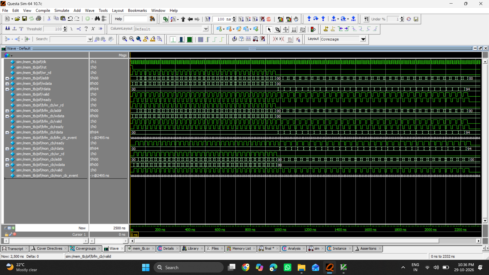
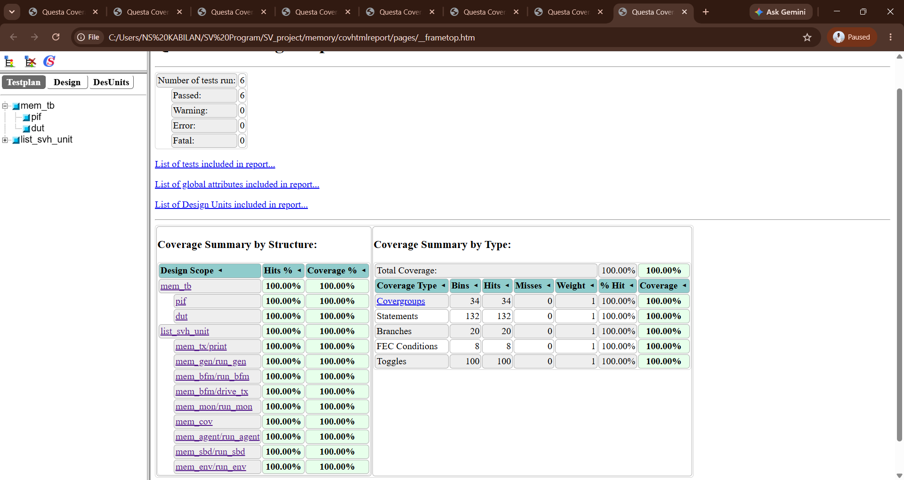

# 32×8 Synchronous Memory Design and SystemVerilog Verification

## Overview

This project implements a **32-word × 8-bit synchronous memory** in
Verilog and verifies its read/write behavior using a modular
SystemVerilog testbench. The verification environment separates stimulus
generation, bus-functional driving, monitoring, checking, and coverage
collection.

The design supports synchronous reset, write and read operations, a
`valid`/`ready` handshake, constrained-random transactions, a
reference-model scoreboard, functional coverage, and SystemVerilog
Assertions (SVA).

## Design Specifications

  -----------------------------------------------------------------------
  Item                                Description
  ----------------------------------- -----------------------------------
  Memory depth                        32 locations

  Data width                          8 bits

  Address width                       5 bits (`$clog2(32)`)

  Interface signals                   `clk`, `rst`, `addr`, `wr_rd`,
                                      `wdata`, `rdata`, `valid`, `ready`

  Read/write control                  `wr_rd = 1` for write; `wr_rd = 0`
                                      for read

  Reset                               Synchronous, active high

  HDL                                 Verilog and SystemVerilog

  Simulator                           QuestaSim / ModelSim
  -----------------------------------------------------------------------

## Verification Architecture

The testbench is organized into separate components to keep
responsibilities clear:

1.  **Generator** creates randomized memory transactions.
2.  **BFM (Bus Functional Model)** drives transactions onto the
    interface.
3.  **Monitor** samples completed transactions and publishes them to the
    scoreboard and coverage collector.
4.  **Scoreboard** compares read data with a reference associative
    array.
5.  **Coverage collector** samples transaction coverage.
6.  **Assertions** check reset behavior, signal knownness, handshake
    timing, and read/write signal conditions.
7.  **Environment and agent** construct and coordinate the verification
    components.

Mailboxes in `mem_comm` connect the generator, BFM, monitor, coverage
collector, and scoreboard.

## Project Folder Structure

Arrange the source files using the following 12 folders:

``` text
memory-verification/
├── 1.designcode/
│   └── memory_sv.v
├── 2.common/
│   └── mem_comm.sv
├── 3.tx/
│   └── mem_tx.sv
├── 4.gen/
│   └── mem_gen.sv
├── 5.bfm/
│   └── mem_bfm.sv
├── 6.mon/
│   └── mem_mon.sv
├── 7.interface/
│   └── mem_if.sv
├── 8.cov/
│   └── mem_cov.sv
├── 9.sbd/
│   └── mem_sbd.sv
├── 10.agent/
│   └── mem_agent.sv
├── 11.env/
│   └── mem_env.sv
├── 12.tb/
│   ├── mem_assert.sv
│   ├── mem_tb.sv
│   └── list.svh
└── README.md
```

> Keep `list.svh` paths consistent with your actual directory layout. If
> your simulator setup expects all files in one directory, adjust the
> include paths or compile script accordingly.

## Folder Responsibilities

  -----------------------------------------------------------------------
  Folder                  Main file(s)            Responsibility
  ----------------------- ----------------------- -----------------------
  `1.designcode`          `memory_sv.v`           RTL memory design,
                                                  reset, read/write
                                                  operations, and ready
                                                  response

  `2.common`              `mem_comm.sv`           Shared test
                                                  configuration,
                                                  counters, and mailboxes

  `3.tx`                  `mem_tx.sv`             Transaction class with
                                                  randomized read/write
                                                  control, address, and
                                                  write data

  `4.gen`                 `mem_gen.sv`            Creates
                                                  directed/randomized
                                                  transactions for
                                                  selected test scenarios

  `5.bfm`                 `mem_bfm.sv`            Drives transactions
                                                  through the virtual
                                                  interface and captures
                                                  read data

  `6.mon`                 `mem_mon.sv`            Observes completed
                                                  interface transactions
                                                  and forwards them to
                                                  checking/coverage

  `7.interface`           `mem_if.sv`             Groups signals and
                                                  defines BFM and monitor
                                                  clocking blocks

  `8.cov`                 `mem_cov.sv`            Functional coverage for
                                                  read/write operations
                                                  and address bins

  `9.sbd`                 `mem_sbd.sv`            Reference-model
                                                  checking using an
                                                  associative array

  `10.agent`              `mem_agent.sv`          Creates and runs
                                                  generator, BFM,
                                                  monitor, and coverage
                                                  components

  `11.env`                `mem_env.sv`            Instantiates the agent
                                                  and scoreboard and runs
                                                  them concurrently

  `12.tb`                 `mem_tb.sv`,            Top-level testbench,
                          `mem_assert.sv`,        DUT connection,
                          `list.svh`              clock/reset,
                                                  assertions, and source
                                                  list
  -----------------------------------------------------------------------

## Test Scenarios

The generator selects a test using the `testname` plusarg.

  -----------------------------------------------------------------------
  Test name                           Purpose
  ----------------------------------- -----------------------------------
  `1wr`                               Generate one write transaction

  `5wr`                               Generate five write transactions

  `1wr_1rd`                           Write to an address, then read back
                                      from the same address

  `5wr_5rd`                           Perform five writes and then read
                                      back the written addresses

  `Nwr_Nrd`                           Perform `N` writes and then read
                                      back the corresponding addresses
  -----------------------------------------------------------------------

For `Nwr_Nrd`, the number of transactions is supplied through the `N`
plusarg. The transaction class uses `randc` for the address, allowing
addresses to cycle without repetition before the cycle repeats.

## Scoreboard and Checking

The scoreboard stores each observed write in an associative array
indexed by address. For a read transaction, it compares the observed
read data against the value stored in the reference model and increments
the matching or mismatching counter.

The testbench prints `TEST PASSED` when at least one match is recorded
and no mismatches are detected. For stronger regression checking,
consider also checking that the expected number of reads completed and
that no transactions remain pending.

## Assertions

`mem_assert.sv` contains properties intended to check:

-   Reset-related signal values.
-   Unknown (`X`/`Z`) values on interface signals after reset.
-   `valid`/`ready` handshake timing.
-   Address and write-data knownness for writes.
-   Address and read-data knownness for reads.

Review assertion sampling and the RTL's synchronous behavior against the
protocol timing before treating these properties as a complete
specification.

## Functional Coverage

The coverage group samples:

-   **Read/write operation:** separate bins for reads and writes.
-   **Address:** individual bins for all 32 addresses (`0` through
    `31`).

The supplied QuestaSim coverage screenshot reports **100% coverage** for
the displayed run across the listed coverage types. Coverage percentages
apply to the configured coverage model and do not, by themselves, prove
that every functional requirement has been verified.

## Simulation Using QuestaSim / ModelSim

Compile the files in dependency order. If `list.svh` contains the source
list and the paths are valid, a typical flow is:

``` tcl
vlib work
vlog list.svh
vopt mem_tb +cover=fcbest -o mem_sim
vsim -coverage mem_sim +testname=Nwr_Nrd +N=32
add wave -r sim:/mem_tb/pif/*
run -all
```

To save a coverage database when the simulation exits, use:

``` tcl
coverage save -onexit Nwr_Nrd.ucdb
```

The exact compile and simulation commands may need adjustment for your
QuestaSim/ModelSim version and folder paths. If the design is compiled
from a file list, ensure `list.svh` includes the files in dependency
order and that the interface and class files are compiled before the
top-level testbench.

## Example Result

For the shown `Nwr_Nrd` simulation with `N=32`, the transcript reports:

``` text
*********TEST PASSED*********
matching=32,mismatching=0
```

The provided coverage report also shows 100% for the coverage categories
configured in that run.

## Simulation Screenshots

### QuestaSim Waveform

The waveform below shows the memory interface signals during simulation.



### Functional Coverage Report

The coverage report below shows the coverage results from the displayed simulation run.



## Tools and Skills Demonstrated

-   Verilog RTL design
-   SystemVerilog testbench development
-   Class-based transaction modeling
-   Constrained-random stimulus generation
-   Virtual interfaces and clocking blocks
-   Mailbox-based communication
-   Bus-functional modeling
-   Functional coverage
-   Scoreboard/reference-model checking
-   SystemVerilog Assertions (SVA)
-   QuestaSim / ModelSim simulation and coverage analysis

## Possible Improvements

-   Add explicit randomization-failure checks.
-   Strengthen the pass/fail condition to verify expected transaction
    counts.
-   Add reset-during-traffic and invalid-address scenarios where
    applicable.
-   Add coverage for read-after-write, repeated access, and reset
    scenarios.
-   Review assertion timing and handshake properties against the
    intended protocol.
-   Use a reproducible regression script to run every test and merge
    coverage databases.

## Author

**Kabilan N S**

Digital Design \| SystemVerilog \| RTL Verification

------------------------------------------------------------------------

This project is intended for learning and demonstrating a modular memory
verification environment.
